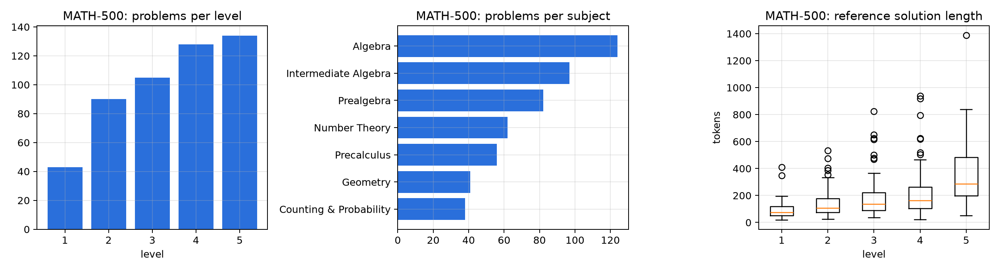
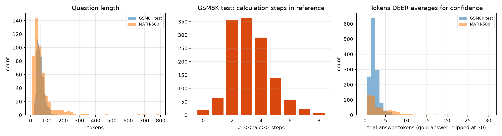

# Dataset exploration

Generated by `scripts/explore_datasets.py`. Token counts use the DeepSeek-R1-Distill-Qwen tokenizer.

## GSM8K

- Test 1319 / train 7473. Question length: mean 61 tokens, max 188.
- Reference solutions use 3.2 calculation steps on average (test), 3.2 (train).
- Answer types (test): {'integer': 1319}; 2 negative.
- Trial-answer tokens DEER averages over: mean 2.29; distribution {1: 253, 2: 639, 3: 296, 4: 78, 5: 30, 6: 19, 7: 3, 9: 1}.
- Duplicate questions inside test: 0. Test questions also in train: 0.

## MATH-500

- 500 problems in the DEER repo's file vs 500 in HuggingFaceH4/MATH-500. Missing: [].
- Levels: {1: 43, 2: 90, 3: 105, 4: 128, 5: 134}.
- Subjects: {'Algebra': 124, 'Intermediate Algebra': 97, 'Prealgebra': 82, 'Number Theory': 62, 'Precalculus': 56, 'Geometry': 41, 'Counting & Probability': 38}.
- Answer types: {'integer': 313, 'expression (sqrt, pi, vars...)': 97, 'fraction': 50, 'tuple/interval/list': 23, 'text/choice': 10, 'decimal': 7}.
- Trial-answer tokens: mean 4.0, median 2, max 31.
- Grader sanity check: 500/500 reference solutions grade as correct.

| Level | n | Question tok | Solution tok | Trial-answer tok | Integer answers |
|---|---|---|---|---|---|
| 1 | 43 | 42 | 98 | 2.7 | 79% |
| 2 | 90 | 53 | 141 | 3.4 | 64% |
| 3 | 105 | 57 | 183 | 4.3 | 62% |
| 4 | 128 | 76 | 213 | 4.3 | 64% |
| 5 | 134 | 98 | 345 | 4.4 | 55% |

