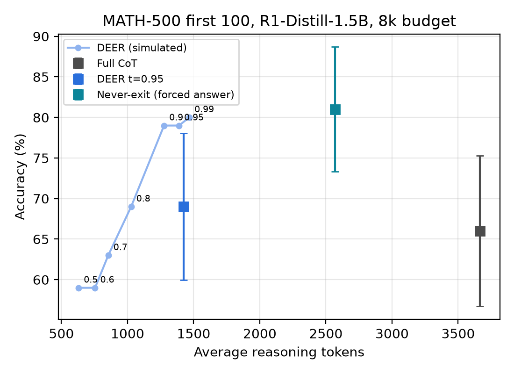
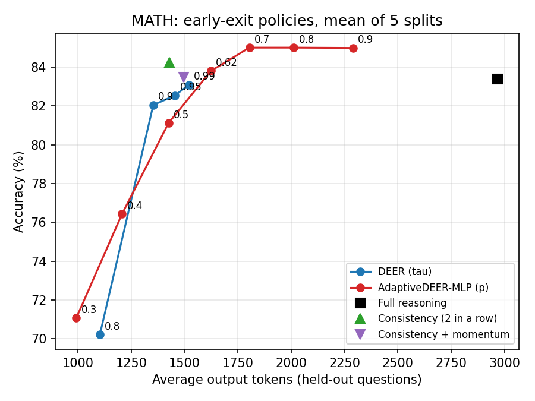
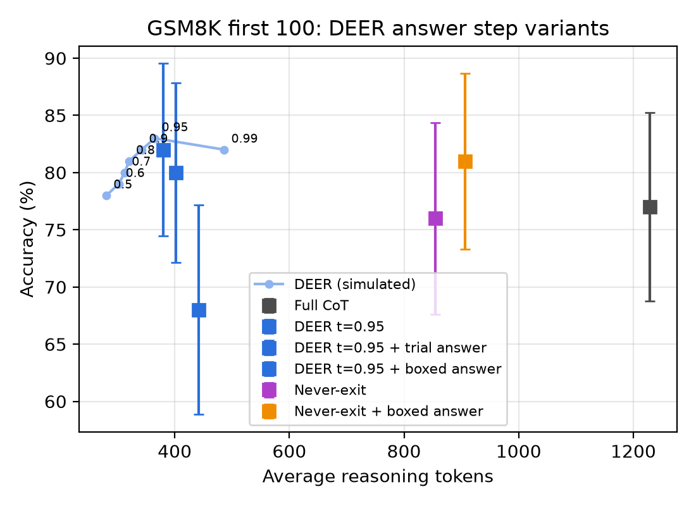
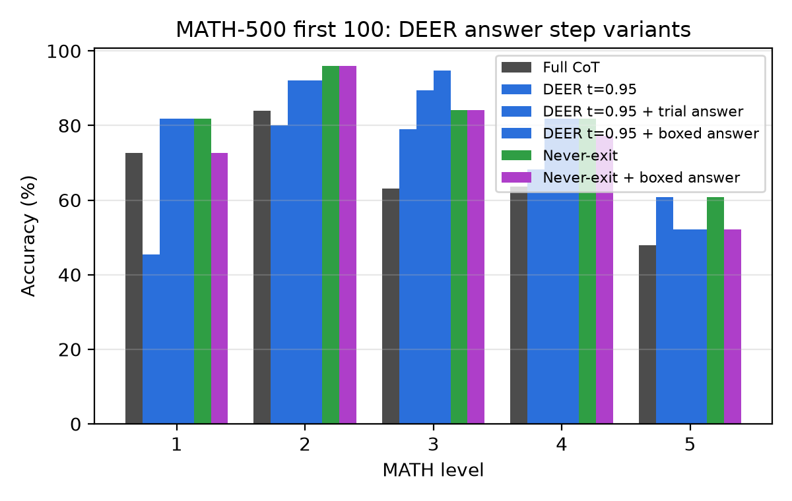
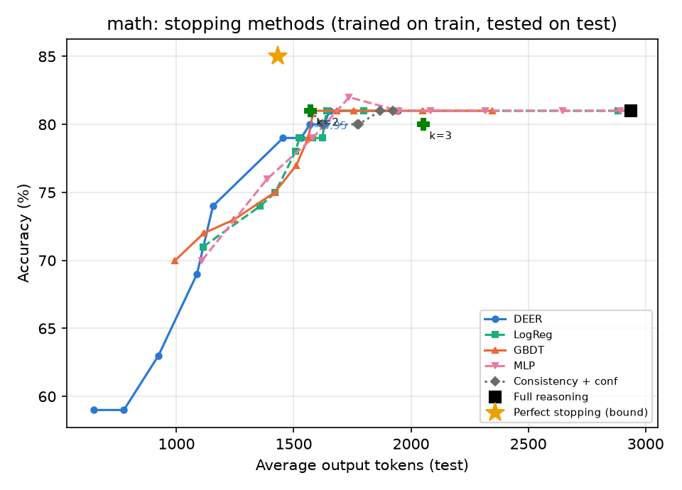

# Adaptive Early Exit for Efficient Reasoning: Reproducing and Extending DEER

**CMPE 258 project report draft (Check-In 4), Group 10**

Jaswanthi Mandalapu (019148883) · Sai Chetan Muppalla (018310504) · Vishnu Sree Peram (018902481)
Department of Computer Engineering, San José State University

Repository: [https://github.com/PeramVishnuSree/Adaptive-Early-Exit-for-Efficient-Reasoning-Reproducing-and-Extending-DEER](https://github.com/PeramVishnuSree/Adaptive-Early-Exit-for-Efficient-Reasoning-Reproducing-and-Extending-DEER)

This draft updates the Check-In 3 report with the measurements already in the repository (commits of 16 November 2026). It does not add a new GPU run. The emphasis is the reading of the figures, which was the feedback on Check-In 3.

---

## Abstract

Reasoning models often keep generating after a correct answer is already available. DEER stops when the confidence of an intermediate trial answer exceeds a fixed threshold, then discards that trial answer and asks the model to write a new one. On DeepSeek-R1-Distill-Qwen-1.5B, the first 100 problems of GSM8K and of MATH-500, and an 8,000-token budget, that rewrite is where official DEER loses accuracy. Keeping the trial answer DEER stopped on raises accuracy from 68% to 82% on GSM8K (McNemar p = 0.001) and from 69% to 79% on MATH-500 (p = 0.041), and it uses fewer tokens. With that fix, DEER matches full-reasoning accuracy at about half the tokens.

A trajectory-aware controller was the project’s extension. Trained on separate training problems and tested on the checkpoint-3 test trajectories, learned stopping matches DEER on GSM8K and uses fewer tokens, and on MATH-500 it lies on or below DEER’s accuracy–token curve. DEER’s own confidence is already a strong score on MATH (ROC-AUC 0.92). The 12 trajectory features raise that only to about 0.94. A perfect stopping rule on the same logs would reach 85% on both sets, so some headroom exists, and these features do not capture it. Every configuration was run once, on 100 problems, and identical runs differ by about four points. Those limits bound every claim below.

## 1. What Check-In 3 asked for, and what this draft does

The Check-In 3 abstract was accepted as written. The request on the graphs was to spend time on what they show, rather than only placing them in the report. This draft therefore reads each figure against the paired tests, and it separates three quantities that the plots put on one set of axes:

- **Accuracy** is the fraction of problems whose last `\boxed{}` matches the reference under DEER’s grader.
- **Reasoning tokens** are tokens before `</think>`. Several plots use this on the x-axis.
- **Output tokens** are reasoning plus the answer. The stopping-method plots use this on the x-axis. A method can look “cheaper” on one axis and not on the other.

Error bars are 95% intervals for a single sample of 100 problems. They are about ±8 points. Two squares whose bars overlap are not an ordering. The McNemar tests and paired bootstrap intervals in the tables are the comparisons that use the same problems twice, and those are the numbers this draft treats as evidence.

## 2. Setup, in one page

The model is DeepSeek-R1-Distill-Qwen-1.5B, float16, vLLM, greedy reasoning, trial answers sampled at temperature 1.0 (official DEER). The budget is 8,000 tokens, with thinking forced to stop at 60% of that budget. DEER’s checkpoint is the token “Wait”. At each checkpoint the script asks for a short trial answer and averages the maximum token probabilities from the second token on (policy `avg1`). It stops when that confidence exceeds τ. Official DEER then appends `</think>` and generates a new answer. The trial answer is thrown away.

Check-In 3 measured Full CoT, live DEER at τ = 0.95, and a never-exit run (τ = 1.1, which is never reached) on the first 100 test problems of each dataset. The never-exit logs are the trajectories the simulator replays. The simulator stops at the first checkpoint a rule accepts and grades that trial answer. It matched live DEER’s exit decision on 100/100 GSM8K problems and 93/100 MATH-500 problems.

Since that check-in the repository adds three things, all under `Vishnu-evaluation/`:

1. `--final_answer trial` keeps the trial answer at an early exit. `--final_answer boxed` still lets the model write the answer, but the prompt starts inside `\boxed{`. `--offset` splits a long run into chunks.
2. Training splits that are not the test set: 1,000 GSM8K training problems and 500 MATH training problems, none of which are in MATH-500.
3. `scripts/compare_stopping_methods.py`, which trains logistic regression, gradient boosting, and the residual MLP on those training trajectories and evaluates them on the Check-In 3 test trajectories. Thresholds are chosen on the training set, at no more tokens than DEER τ = 0.95, and then frozen.

Raw generation logs for the new runs are not in git. The notebooks write them to Google Drive under `MyDrive/deer_final/<job>`. Tables, plots, and scored summaries are in git at the paths in Section 6.

## 3. Reading the Check-In 3 figures

### 3.1 The MATH tradeoff is mostly a budget story, then a formatting story



*Figure 1. MATH-500, first 100 problems. Accuracy versus average reasoning tokens. The curve is DEER replayed offline at several thresholds and scored on the trial answer. Squares are live runs. Source: `Vishnu-evaluation/results/checkpoint3/comparison_math/tradeoff.png`.*

Three readings, in the order the plot forces them.

The curve flattens. From τ = 0.5 to τ = 0.8, accuracy climbs from 59% to 69% while reasoning tokens go from 630 to 1,027. From τ = 0.9 to τ = 0.99, accuracy stays at 79–80% and tokens only move from 1,276 to 1,467. Once confidence is high, waiting longer does not buy correct trial answers on this set. A learned rule that “saves tokens by exiting a bit earlier than τ = 0.95” is walking down a slope the curve has already measured.

Full CoT (66%, about 3,665 reasoning tokens) sits to the right of and below the never-exit point (81%, about 2,570 reasoning tokens). Those two runs both reason until they stop or hit the budget. They differ because Full CoT that hits the limit is graded wrong: 32 of 100 MATH problems produced no answer. DEER’s script, including the never-exit run, inserts `</think>` at 4,800 thinking tokens and still writes an answer. On problems where neither run hit the budget, Check-In 3 found the two pipelines agree. The vertical gap between the gray and teal squares is a budget-and-format effect, not evidence that “more reasoning hurts.”

Official DEER (69%, about 1,423 reasoning tokens) sits well below the simulated curve at a similar x-position. The curve at τ = 0.95 is 79% at 1,389 reasoning tokens. The live run made nearly the same exit decisions. Rescoring those exits on the trial answer recovers 79% on MATH and 82% on GSM8K. The square is low because the answer written after `</think>` is often unboxed. On the Check-In 3 early exits, the trial answer was correct 87% of the time on both datasets, and the regenerated final answer was correct 42% of the time on GSM8K and 74% on MATH-500.

The GSM8K companion plot tells the same story with a thinner checkpoint set. Live DEER is 68% at 442 reasoning tokens. The offline sweep at τ = 0.95 is 83% at 365 reasoning tokens. Full CoT is 77% at 1,229 reasoning tokens. Sixty-four of the 100 GSM8K problems never emit “Wait”, so DEER cannot exit early on them. Any controller is judged on the other 36 problems.

### 3.2 Held-out MLP curves sit on DEER’s curve



*Figure 2. AdaptiveDEER-MLP and fixed thresholds on held-out MATH problems, mean over five question splits of the same 100-problem logs. Early exits are scored on the trial answer. Source: `Saichetan-adaptive/results/checkpoint3_real/tradeoff_math.png`.*

Checkpoint-level ROC-AUC on these logs is 0.920 for the MLP and 0.929 for raw confidence. The plot is the policy consequence: MLP thresholds from 0.5 to 0.9 trace the same rising-then-flat shape as DEER’s τ sweep. The consistency rule (same trial answer twice) lands next to DEER τ = 0.95, at 84.2% versus 82.5%, inside the split-to-split standard deviation (about ±4 points, and only about 31 MATH questions per split). Check-In 3’s claim that the controller is on par with DEER, not better, is what this figure shows. It was also trained and tested on splits of the same 200 problems. Section 4 is the fairer test.

## 4. Reading the Check-In 4 figures

### 4.1 The answer-step plot: the low square was the rewrite



*Figure 3. GSM8K, first 100. Live answer-step variants against the same offline DEER curve as Figure 1. The x-axis is reasoning tokens. Source: `Vishnu-evaluation/results/checkpoint4/answer_fix_gsm8k/tradeoff.png`.*

| Method | GSM8K acc / output tokens | MATH-500 acc / output tokens |
|---|---|---|
| Full CoT | 77% / 1,452 | 66% / 3,894 |
| DEER τ = 0.95 (official rewrite) | 68% / 773 | 69% / 1,747 |
| DEER τ = 0.95, keep trial answer | **82% / 592** | **79% / 1,446** |
| DEER τ = 0.95, boxed prompt | 80% / 556 | 80% / 1,833 |
| Never-exit | 76% / 1,123 | 81% / 2,937 |
| Never-exit + boxed prompt | 81% / 1,058 | 77% / 2,988 |

On the GSM8K figure, official DEER is the low square, near 68% and about 440 reasoning tokens. The trial-answer run is the square that sits on the simulated curve, at 82% and 380 reasoning tokens. The boxed-prompt run is next to it (80%, 402 reasoning tokens). Full CoT and the two never-exit runs are the cluster on the right, between 76% and 81%, past 850 reasoning tokens. The error bars all span several points. The paired tests are what separate the squares:

| Comparison | GSM8K | MATH-500 |
|---|---|---|
| Trial answer vs official DEER | +14 points (p = 0.001), −181 output tokens (CI −381, −13) | +10 points (p = 0.041), −301 tokens (CI −489, −116) |
| Boxed prompt vs official DEER | +12 points (p = 0.023), −217 tokens | +11 points (p = 0.043), +86 tokens (CI includes 0) |
| Trial answer vs Full CoT | +5 points (p = 0.13), −860 tokens | +13 points (p = 0.004), −2,448 tokens |
| Trial answer vs never-exit | +6 points (p = 0.07) | −2 points (p = 0.73), −1,491 tokens |

The figure supports a narrow claim. The stopping decision at τ = 0.95 was already close to the offline curve. Writing a new answer after `</think>` dropped the GSM8K point off that curve. Putting the trial answer back puts the point back, and it is cheaper than the boxed prompt because no new answer is generated. On MATH the boxed prompt matches the trial answer’s accuracy (80% vs 79%) and does not save tokens (the token CI includes zero). Keeping the trial answer is the better of the two fixes on both axes.

The same figure warns against reading the right-hand cluster as a ranking. Never-exit and never-exit-plus-boxed use the same greedy settings. They produced the same reasoning on 82 of 100 GSM8K problems and only 52 of 100 MATH problems. vLLM float16 batching is not bit-exact. On MATH those two runs are 81% and 77% (p = 0.29). A four-point gap between single runs is the noise floor. The large MATH gap between trial-answer DEER (79%) and Full CoT (66%) is real in the paired test, and part of it is still the budget: Full CoT has no answer on 32 of 100 MATH problems.

The offline simulator predicted 82% and 79% for “DEER scored on the trial answer.” The live trial-answer runs produced 82% and 79%. That is the check that the simulator is describing this fix, not a different experiment.



*Figure 4. MATH-500, first 100, accuracy by difficulty level. Level counts in this slice are 11, 25, 19, 22, and 23. Source: `Vishnu-evaluation/results/checkpoint4/answer_fix_math/accuracy_by_level.png`.*

Level 5 is the hard band for every method: bars sit near 50–60%, and Full CoT is the lowest there. Levels 2 and 3 are where the answer-step fixes separate from official DEER; official DEER is visibly lower on level 1 than the trial-answer and never-exit bars. Per-level counts are small (11 problems at level 1), so a single bar moving by one problem is about nine points. The plot is a description of where the aggregate gain shows up. It is not five separate significant tests. The token-by-level companion (`tokens_by_level.png`) shows the same pattern as the aggregate: early exit shortens reasoning at every level, and the hardest level still uses the longest traces.

### 4.2 Learned stopping: a better score is not a better policy



*Figure 5. Stopping methods trained on 500 MATH training problems and replayed on the 100 MATH-500 test trajectories. The x-axis is average output tokens. Each learned curve is that model at several thresholds. The star is perfect stopping. Source: `Vishnu-evaluation/results/checkpoint4/methods_math/tradeoff_math.png`.*

This is the figure that answers the project hypothesis.

DEER’s curve is the solid blue line. It rises from about 59% near 700 output tokens to about 79% near 1,500, then flattens near 81%, which is full reasoning at about 2,900 tokens. Logistic regression, gradient boosting, and the MLP (dashed) follow that same rise and the same flat region. They do not draw a line above DEER. Where they sit to the left of DEER, they also sit lower: fewer tokens, lower accuracy, which is what DEER itself does at a smaller τ.

The star is perfect stopping: stop at the first checkpoint whose trial answer is correct. It is at 85% and 1,431 output tokens, six points above DEER τ = 0.95 (paired CI +2 to +11). That gap is the room a stopping rule could still use. None of the logged features reach it. The star is an upper bound on these logs, not a method.

The operating points chosen on the training set, then frozen, make the same point in a table. On MATH-500, DEER τ = 0.95 is 79% at 1,531 output tokens. Logistic regression matches it exactly (79%, 1,524 tokens, accuracy CI of 0 to 0). The MLP is 76% at 1,387 tokens (accuracy CI −8 to +1, token CI −261 to −54). Gradient boosting is 75% at 1,419 tokens. Both save tokens by giving up accuracy, and the accuracy loss is not clearly significant at n = 100. Consistency (the same answer at two checkpoints) is 81% at 1,571 tokens, the only point that sits slightly above DEER’s curve, and the accuracy CI is −2 to +6.

ROC-AUC says why the curves stack. On MATH test checkpoints, confidence alone is 0.921. Logistic regression is 0.943, the MLP 0.936, gradient boosting 0.934. The features add a small amount of ranking power on top of a score that is already strong. A policy that thresholds that score cannot pull away from DEER’s curve.

GSM8K is the dataset where confidence is weaker, and the result is different in degree, not in kind.

| Method (threshold frozen on the training set) | Acc. | Output tokens | Δ acc vs DEER (95% CI) | Δ tokens vs DEER (95% CI) |
|---|---|---|---|---|
| Full reasoning | 76% | 1,123 | −6 (−11, −2) | +495 |
| Perfect stopping | 85% | 659 | +3 (0, +7) | +31 |
| DEER τ = 0.95 | 82% | 628 | — | — |
| Logistic regression | 82% | 573 | 0 (−4, +4) | **−55 (−139, −8)** |
| MLP | 82% | 596 | 0 (−4, +4) | −31 (−191, +125) |
| Gradient boosting | 83% | 535 | +1 (−3, +5) | **−93 (−212, −11)** |
| GBDT, confidence features only | 84% | 537 | +2 (−2, +6) | **−91 (−210, −9)** |
| GBDT, confidence + answer stability | 85% | 552 | +3 (0, +7) | −76 (−195, +5) |

Checkpoint AUC on GSM8K is 0.779 for confidence, 0.914 for logistic regression, and 0.912 for the MLP. The learned scores rank trial answers better. At the policy level the accuracy intervals all include zero, except the stability-augmented gradient boosting, whose interval touches zero at the low end (+3 points, CI 0 to +7) and whose token interval also includes zero. The token savings for logistic regression and for gradient boosting exclude zero. The supported GSM8K claim is: same accuracy as DEER, fewer tokens. It is not a significant accuracy gain.

Two details keep that claim from being over-read. Only 36 of 100 GSM8K test problems ever reach a checkpoint, so the controller is scored on a small subset and the other 64 problems are identical for every method. And gradient boosting on confidence features alone has AUC 0.706, worse than raw confidence, while its chosen threshold posts 84% accuracy. Ranking quality and the operating point are different objects. A threshold picked on a modest training set can land on a flattering point. The accuracy interval (−2 to +6) already says that 84% is compatible with no gain.

Training one model on both datasets repeats the split: on GSM8K, logistic regression reaches 83% with 51 fewer tokens than DEER (CI −129 to −6); on MATH-500 the learned methods are again at or below DEER, and the MLP’s accuracy drop is significant in that combined run.

## 5. What the project can say

The graphs support four sentences, and they do not support a fifth.

1. DEER’s decision to stop is in good shape. The trial answer at the exit is usually right. Official accuracy was low because the next step rewrote the answer and often dropped `\boxed{}`.
2. Keeping that trial answer is a measured improvement: +14 points on GSM8K and +10 on MATH-500, with fewer tokens, in a paired test. It matches full reasoning at roughly half the tokens. The simulator predicted the live accuracies exactly.
3. Where confidence is a weak ranker (GSM8K, AUC 0.78), trajectory features rank trial answers better (AUC 0.91) and a frozen threshold saves a significant number of tokens at the same accuracy.
4. Where confidence is already strong (MATH, AUC 0.92), the same features do not move the accuracy–token curve. Perfect stopping shows a six-point gap that these logs do not close. Answer stability is a cheap signal and, on MATH, the only rule that even sits slightly above DEER, without a significant difference.

The sentence the figures do not support is that a learned controller beats a fixed threshold. Check-In 2’s synthetic bake-off is not this result. The real trajectories are.

That is a usable outcome for the final report. The extension was tested on held-out training problems, with an upper bound and with intervals, and the positive engineering result is the answer step.

## 6. Artifacts

Repository (code, notebooks, tables, and the figures in this draft):

[https://github.com/PeramVishnuSree/Adaptive-Early-Exit-for-Efficient-Reasoning-Reproducing-and-Extending-DEER](https://github.com/PeramVishnuSree/Adaptive-Early-Exit-for-Efficient-Reasoning-Reproducing-and-Extending-DEER)

| What | Path in the repository |
|---|---|
| This draft | `docs/CMPE258_Group10_Report_Draft.md` |
| Check-In 4 tables and plots | `Vishnu-evaluation/results/checkpoint4/` |
| Answer-step figures | `Vishnu-evaluation/results/checkpoint4/answer_fix_gsm8k/`, `answer_fix_math/` |
| Stopping-method figures | `Vishnu-evaluation/results/checkpoint4/methods_gsm8k/`, `methods_math/`, `methods_combined/` |
| Check-In 3 figures and never-exit logs | `Vishnu-evaluation/results/checkpoint3/` |
| Live Full CoT and DEER runs; MLP on those logs | `Saichetan-adaptive/checkpoint_runs/`, `Saichetan-adaptive/results/checkpoint3_real/` |
| Logged DEER script (`--final_answer`, `--offset`) | `Vishnu-evaluation/third_party/deer/vllm_deer_logged.py` |
| Training splits | `Vishnu-evaluation/data/gsm8k_train/`, `data/math_train/` |
| Comparison script | `Vishnu-evaluation/scripts/compare_stopping_methods.py` |
| Colab notebook for the Check-In 4 jobs | `Vishnu-evaluation/notebooks/04_training_trajectories_and_answer_fix.ipynb` |
| Check-In 3 never-exit notebook | `Vishnu-evaluation/notebooks/02_checkpoint3_never_exit.ipynb` |
| Baseline reproduction notebook | `Jaswanthi Mandalapu/CMPE_258_Project_CheckIn_2_JM.ipynb` |

Generation logs that are too large for git are written by the notebooks to Google Drive at `MyDrive/deer_final/<job>`, `MyDrive/deer_ckpt/`, and `MyDrive/CMPE258_Group10_DEER/`. Those folders are not a public link. The shared Drive URL still has to be pasted here, and the instructor and TA still have to be given access to that folder.

To rebuild the stopping-method tables from the scored logs (CPU, from `Vishnu-evaluation/`):

```bash
python scripts/compare_stopping_methods.py \
  --train math=outputs/final/math_train/never_math_train.scored.jsonl \
  --test  math=results/checkpoint3/never_exit/never_math.scored.jsonl \
  --out_dir results/checkpoint4/methods_math
```

The unit tests that cover scoring, the simulator, and the new DEER flags are `python -m pytest` in `Vishnu-evaluation/` (35 tests) and in `Saichetan-adaptive/` (5 tests).

## 7. Access and check-ins

GitHub collaborators on this repository, as of this draft, are the three authors (`PeramVishnuSree`, `saichetanmuppalla-sjsu`, `jaswanthimandalapu-stack`). The instructor and the TA are not on that list. Check-In 3 stated that they had workspace access. That invite has to be confirmed on both the GitHub repository and the Drive folder before submission. Their GitHub usernames are not in the repository, so this draft cannot send the invite.

Commits after the Check-In 3 snapshot (2 November 2026):

| Commit | Date | What it added |
|---|---|---|
| `276e669` | 16 Nov 2026 | Training splits, `--final_answer` and `--offset`, the comparison script, notebook 04 |
| `bd7379c` | 16 Nov 2026 | Live answer-fix results and the GSM8K stopping comparison |
| `346e3fb` | 16 Nov 2026 | MATH and combined stopping-method results |

The check-in asks for on the order of 8–10 meaningful check-ins since the previous one. The history since 2 November is these three commits, all on 16 November. This draft does not split them into extra commits. The final report should not describe a longer check-in record than the repository has.

## 8. Limits, and what the final report still has to decide

The final report cannot be revised after it is submitted. These limits should stay visible in it.

- One hundred problems per dataset, one run each. GSM8K contributes only 36 problems with a checkpoint. Intervals of about ±4 points are the resolution of the study.
- The 8,000-token budget is half of DEER’s paper budget. On MATH, 32% of Full CoT and 30% of never-exit hit it.
- Learned policies were replayed offline. The simulator matched live DEER. It has not been checked by running the MLP inside generation.
- Trial answers are sampled at temperature 1.0, so both the labels and the exit decisions move between runs.

The final report can be this draft with the prose tightened into the course template. It should not add a claim that needs a run this repository does not contain. The runs that would change the conclusion, if there is time before the final deadline, are the full GSM8K test set (1,319) and all of MATH-500, a second repeat of the trial-answer comparison, and one live pass of the best GSM8K threshold inside the logged loop. If those runs do not happen, the conclusion in Section 5 is the one the figures support.

## References

[1] Z. Yang et al., “Dynamic Early Exit in Reasoning Models (DEER),” ICLR, 2026.

[2] DeepSeek-AI, “DeepSeek-R1: Incentivizing Reasoning Capability in LLMs via Reinforcement Learning,” arXiv:2501.12948, 2025.

[3] K. Cobbe et al., “Training Verifiers to Solve Math Word Problems,” arXiv:2110.14168, 2021.

[4] D. Hendrycks et al., “Measuring Mathematical Problem Solving With the MATH Dataset,” NeurIPS Datasets and Benchmarks, 2021.

[5] H. Lightman et al., “Let’s Verify Step by Step,” ICLR, 2024.

[6] W. Kwon et al., “Efficient Memory Management for Large Language Model Serving with PagedAttention,” SOSP, 2023.
